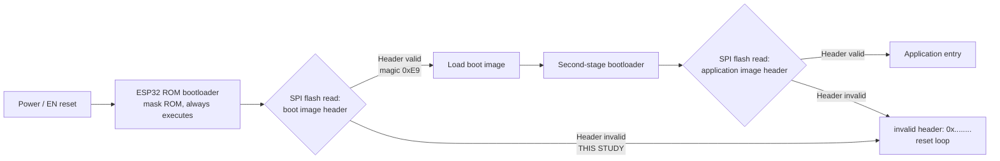
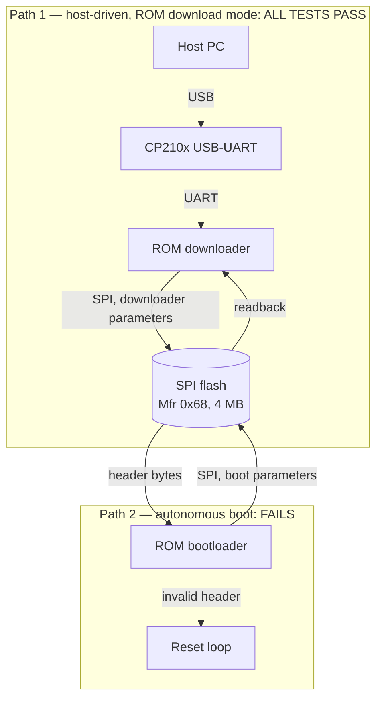
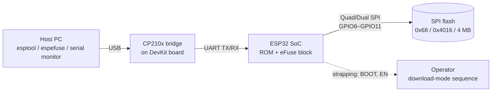

# Architecture — Boot Chain and Diagnostic Setup

## 1. ESP32 boot chain (as relevant to this fault)

Facts the investigation relies on:

- The ROM bootloader is mask ROM: it cannot be corrupted by flashing, and Entry 03 of the investigation log proves it executes (download mode works).
- A valid image header starts with magic byte `0xE9`. Observed boot values (`0x3ffea272` etc.) are not valid headers and are not stable.
- Flash regions relevant here: bootloader image at `0x1000` (erase verified at this address), application image at `0x10000`.

## 2. The two flash-read paths

The investigation's central structural fact: Path 1 and Path 2 traverse the same physical flash and the same SPI pins, under different drivers and parameters. Path 1 passes completely (write, verify, erase-verify, readback + image validation). Path 2 fails with parameter-dependent garbage. The fault therefore lives in what differs between the paths: boot-time interface behaviour and/or the security/configuration state that conditions boot.

## 3. Diagnostic setup

Components and their verified state in this study:

| Component | Role | State |
|---|---|---|
| Host PC + esptool/espefuse | Drives Path 1, captures evidence | Functional |
| CP210x bridge | USB↔UART | Enumerates, communicates (T1, T3) |
| ESP32 ROM | Executes download mode and boot attempt | Executes (T4, T5) |
| eFuse block | Security/configuration state | Accessible; abnormal values (T9) |
| SPI flash | Stores boot + application images | Host-side operations all pass (T6–T8, T11–T13) |
| SPI interface at boot | Carries the header read in Path 2 | **Suspect — inside the remaining fault domain** |
