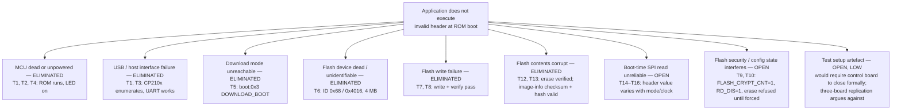

# Failure Tree — Application Does Not Execute

Top event: **verified firmware in flash, application never runs (ROM reports `invalid header`)**.
Branch status: **ELIMINATED** (closed by a named test) or **OPEN** (inside the remaining fault domain).

## Branch notes

**Eliminated branches** each rest on a direct observation, not on inference: the ROM prints logs (not dead), the downloader answers (not unreachable), the image validates structurally (not corrupt). Closing these branches is what makes the open set meaningful.

**Open branch G — boot-time SPI read.** Supported by: valid stored data (F closed) plus non-deterministic header values that track SPI mode and frequency (T14–T16). Not yet discriminated from H with the available instruments; a bus capture discriminates directly.

**Open branch H — security/configuration.** Supported by: eFuse state abnormal for new boards (T9) and erase refusal consistent with active security features (T10). Explains T10, which G alone does not. Interaction between encryption state and boot image handling is the specific sub-hypothesis to test.

**Open branch I — setup artefact.** Methodological honesty: with no known-good control board, the setup cannot be *formally* exonerated. Three-board replication and the specificity of the symptom pattern make it unlikely. Experiment 1 in POST_MORTEM.md §6 closes this branch.

## Using this tree

For any "flashes fine, won't boot" failure: work the tree top-down, cheapest tests first (they are ordered so here). Do not open G/H-class branches (instrumentation, configuration forensics) until the six eliminations above them are actually closed by observation.
