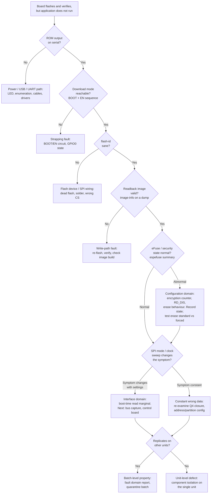

# Troubleshooting Flowchart — "Flashes Fine, Won't Boot" (ESP32 class)

A reusable diagnostic flow, generalised from this investigation. Each step names the observation that lets you proceed. The discipline: never advance on an assumption; every arrow is an observed result.

## Notes on using this flow

- **Order is deliberate.** The first four questions cost minutes and close the majority of real-world cases. Security-state and interface work (Q5, Q6) is expensive in time and interpretation; it is wasted effort if Q1–Q4 are not closed first.
- **Record exact error values at every step.** In this investigation, the *values* of the invalid headers, and how they changed at Q6, were the evidence that separated the interface domain from the content domain. "It still fails" is not an observation; "fails with 0x8e465484 at DIO 40 MHz" is.
- **Erase behaviour is a free security probe.** A standard erase that refuses, where a forced erase succeeds, tells you security features are active before you ever read an eFuse (Q5 corroboration).
- **Replication is the last gate, not the first.** Establish the fault on one unit, then replicate. Conclusions drawn before replication are unit anecdotes regardless of how thorough the single-unit work was.
- **Stopping rule.** When the next discriminating step needs equipment or a control unit you do not have, the correct output is a fault-domain statement plus the defined next experiment — not a best guess dressed as a root cause.
